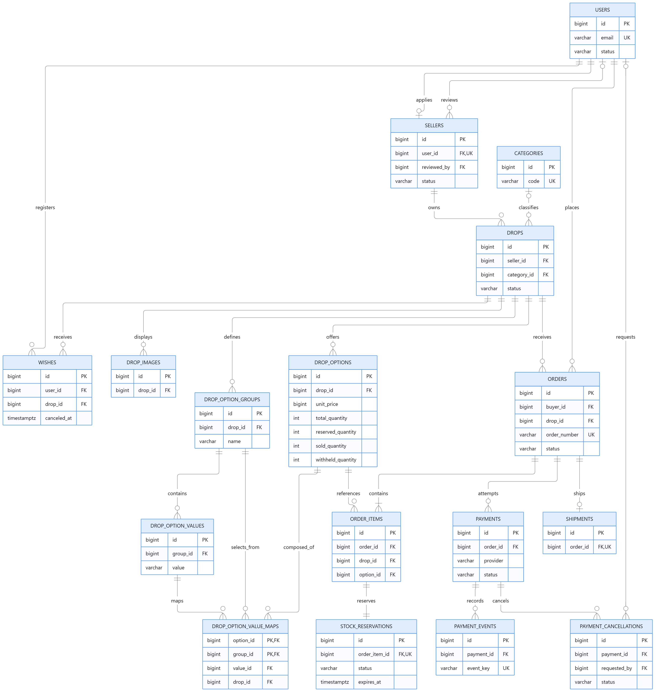

# GRAB ERD



> 위 이미지는 핵심 업무 관계를 요약한 개념도이며, 공통 시각 컬럼은 아래 테이블 정의를 기준으로 한다.

## 0. 공통 규칙

- 주요 업무 테이블은 `created_at`, `updated_at`을 `TIMESTAMPTZ`로 가진다.
- 판매 가능 여부, 예약 만료 및 상태 전이는 서버 시각을 기준으로 판단한다.
- API가 반환하는 `SELLER` 권한은 별도 회원 역할 컬럼이 아니라 `sellers.status = APPROVED`에서 파생한다.
- 알림은 MVP에서 SMTP 메일로만 제공한다. 사용자에게 보여주는 인앱 알림 목록(읽음 표시 등)은 범위 밖이라 수신자별 알림 테이블을 두지 않는다.
  메일 중복 발송을 막을 토큰이 필요한 알림만 발송 기록을 테이블로 남긴다. 판매 시작 알림(GR-69)은 `drops.status`의 `WISH → GRAB` 전환
  자체가 한 번만 성공하므로 기록이 필요 없고, 상태가 바뀌지 않는 알림(판매 시작 n분 전 등)은 기록 없이는 스케줄러 주기마다 재발송된다.
- PK는 모든 테이블에서 `BIGINT` 자동 증가 값을 쓰고 내부 조인·정렬·행 잠금에만 사용한다.
  외부에 노출하는 리소스는 `public_id UUID`(UQ)를 별도로 두고, API 경로·응답·외부 연동에는 `public_id`만 내보낸다.
  대상은 `users`, `sellers`, `drop_images`, `orders`, `payments`, `payment_cancellations`이다.
  `drops`와 그 옵션 계열은 공개 카탈로그라 열거되어도 노출되는 정보가 없고,
  `drop_options`는 재고 차감 시 `ORDER BY id`로 행을 잠그는 경로라 `BIGINT` PK만 사용한다.

### GR-109 공개 카탈로그 변경 전달

[실시간 변경 전달 계약](REALTIME_STOCK.md)은 SSE 변경 알림 후 기존 API 재조회 방식이며 스키마 변경이 필요하지 않다. 상품 버전 컬럼·이벤트 이력·아웃박스·수신자 알림 테이블과 Flyway 마이그레이션을 추가하지 않는다. 위 SMTP 알림은 사용자에게 발송하는 판매 소식이고, SSE는 공개 카탈로그의 일시적 갱신 신호다. PostgreSQL 원장·가용 재고 계산·3.1~3.3절 트랜잭션과 행 잠금은 유지한다. Redis 전달 유실은 최신 조회로 복구하며 재고 판단 근거로 사용하지 않는다.

## 1. 테이블 정의

### 1.1 회원 및 판매자

#### `users`

| 컬럼                  | 타입           | 필수  | 설명                                 |
|---------------------|--------------|-----|------------------------------------|
| `id`                | BIGINT       | O   | PK                                 |
| `public_id`         | UUID         | O   | UQ, 외부 노출 식별자                      |
| `email`             | VARCHAR(254) | O   | UQ, 정규화 후 저장                       |
| `password_hash`     | VARCHAR(255) | 조건부 | LOCAL 회원만 필수, Argon2id 해시 저장       |
| `nickname`          | VARCHAR(100) | O   | 닉네임, 대소문자 무시 UQ                   |
| `profile_image_url` | VARCHAR(500) | X   | 이미지 객체 키 또는 영속 URL                 |
| `role`              | VARCHAR(20)  | O   | `USER`, `ADMIN`                    |
| `status`            | VARCHAR(20)  | O   | `ACTIVE`, `SUSPENDED`, `WITHDRAWN` |
| `provider`          | VARCHAR(20)  | O   | `LOCAL`, `KAKAO`, `GOOGLE`         |
| `provider_user_id`  | VARCHAR(255) | 조건부 | 소셜 회원만 필수, 제공자 고유 사용자 식별자(OIDC `sub`). UQ(`provider`, `provider_user_id`) |
| `created_at`        | TIMESTAMPTZ  | O   | 회원 생성 시각                           |
| `updated_at`        | TIMESTAMPTZ  | O   | 회원 정보 최종 수정 시각                     |


판매자는 회원의 배타적인 역할이 아니다. `sellers.status = APPROVED`인 회원에게 판매자 기능을 허용한다.

MVP 회원가입은 `LOCAL` 및 소셜 로그인 `KAKAO`, `GOOGLE`을 구현한다. 회원 휴대폰 번호는 수집·저장하지 않으며, 배송 연락처는 주문 시 `orders.recipient_phone`으로 받는다.

소셜 회원은 이메일이 아니라 `provider`와 `provider_user_id`로 식별한다. 제공자 쪽 이메일이 바뀌어도 같은 회원으로 로그인하며, 저장된 `email`은 갱신하지 않는다.
- `LOCAL` 회원은 `provider_user_id`가 NULL이고, 소셜 회원은 필수다(`ck_users_social_identifier`).
- 소셜 회원은 `password_hash`를 저장하지 않는다. DB 제약은 LOCAL의 해시 필수(`ck_users_local_password`)뿐이고,
  소셜 회원의 NULL은 가입 코드(`User.createSocial`)가 보장한다.
- 한 회원은 하나의 제공자에만 속한다. 같은 이메일의 다른 가입 방식 계정은 자동으로 연결하지 않는다(`ACCOUNT_LINK_REQUIRED`). `email` UQ도 이를 보장한다.

`nickname`은 회원이 직접 정하는 닉네임이며 본명이 아니다. 기존 `display_name` 컬럼의 이름을 바꾼 것이다. 회원 본명은 수집하지 않으며, 배송에 필요한 수령인 이름은 주문 시 `orders.recipient_name`으로 받는다.
닉네임은 리뷰 등 공개 기능에서 다른 회원에게 노출되므로 중복을 허용하지 않는다.
- 입력한 대소문자는 그대로 저장하고, 중복 판단은 대소문자를 구분하지 않는다. `lower(nickname)` 기준 유니크 인덱스(`uq_users_nickname_lower`)로 보장한다.
- 서버의 사전 중복 검사는 사용자에게 빠르게 알리기 위한 것이며, 동시 요청의 최종 판단은 DB 유니크 인덱스가 한다. 인덱스 위반은 `DUPLICATE_NICKNAME`으로 변환한다.
- 탈퇴(`WITHDRAWN`) 시 닉네임을 `withdrawn_<public_id>` 형식의 익명 값으로 바꿔 기존 닉네임을 해제한다. 이 값은 입력 규칙(길이·허용 문자)을 벗어나므로 사용자가 입력한 닉네임과 겹치지 않는다.
- 입력 규칙은 API 명세(`MEMBER_AUTH.md` 1.2.3절)를 따르며, 컬럼 길이는 익명 값과 규칙 변경 여지를 위해 여유 있게 둔다.

#### 인증 토큰 저장 정책

Access Token은 짧은 수명의 JWT로 발급해 서버에 저장하지 않고 HttpOnly 쿠키로 전달한다. Refresh Token은 무작위 문자열로 발급해 HttpOnly 쿠키로 전달하고 해시만 Redis에 TTL과 함께 저장한다. 재발급 시 두 쿠키를 교체하고 로그아웃 시 Redis의 Refresh Token과 두 쿠키를 삭제한다.

#### `sellers`

| 컬럼 | 타입 | 필수 | 설명 |
| --- | --- | --- | --- |
| `id` | BIGINT | O | PK |
| `public_id` | UUID | O | UQ, 외부 노출 식별자 |
| `user_id` | BIGINT | O | FK users, UQ |
| `brand_name` | VARCHAR(100) | O | 브랜드명 |
| `contact_email` | VARCHAR(254) | O | 판매자 연락 이메일 |
| `business_registration_number` | VARCHAR(10) | O | UQ, 사업자등록번호(하이픈 제거 10자리 숫자) |
| `description` | TEXT | X | 브랜드 소개 |
| `status` | VARCHAR(20) | O | `PENDING`, `APPROVED`, `REJECTED` |
| `submitted_at` | TIMESTAMPTZ | O | 신청 시각 |
| `reviewed_by` | BIGINT | X | FK users, 관리자 심사자 |
| `reviewed_at` | TIMESTAMPTZ | X | 심사 시각 |
| `rejection_reason` | TEXT | X | 반려 시 필수 |

MVP에서는 판매자 신청과 프로필을 한 테이블에서 관리한다. 신청 이력 보존이 필요해지면 `seller_applications`를 별도 분리한다.

반려(`REJECTED`) 후 재신청은 새 행을 만들지 않고 기존 행을 갱신한다(`uq_sellers_user` 유지). 같은 사용자가 `PENDING`·`APPROVED` 상태일 때 다시 신청하면 거부한다.

`business_registration_number`는 국세청 사업자등록정보 **상태조회 API**(진위확인 API 아님, 대표자성명·개업일자는 받지 않는다)로 1차 검증한다.

- 조회 결과가 `계속사업자`가 아니면(휴업자·폐업자) 신청 자체를 거부한다.
- 외부 API 장애·타임아웃 시에는 신청을 막지 않는다. 검증을 생략한 채 `PENDING`으로 접수하고, 운영자가 승인 전 수동으로 사업자 상태를 확인한다.
- 같은 사업자등록번호로 복수 계정이 신청하는 것은 `uq_sellers_user`가 아니라 이 UQ로 막는다.

#### `seller_documents`

| 컬럼 | 타입 | 필수 | 설명 |
| --- | --- | --- | --- |
| `id` | UUID | O | PK, 업로드 시 발급하는 `documentId` |
| `uploaded_by` | BIGINT | O | FK users, 업로드한 회원 |
| `seller_id` | BIGINT | X | FK sellers, 신청 제출 전 먼저 업로드되므로 생성 시점엔 `NULL`일 수 있다 |
| `document_type` | VARCHAR(30) | O | `BUSINESS_LICENSE`, `ID_CARD`, `BANKBOOK`, `MAIL_ORDER_BUSINESS_REPORT` |
| `content_type` | VARCHAR(100) | O | 원본 파일의 MIME 타입(복호화 후 스트리밍 응답에 사용) |
| `encrypted_object_key` | VARCHAR(500) | O | 비공개 버킷(`seller-documents`)에 저장된 암호문 객체 키 |
| `encrypted_dek` | VARCHAR(500) | O | 마스터키로 암호화한 DEK (봉투 암호화) |
| `created_at` | TIMESTAMPTZ | O | 업로드 시각 |
| `updated_at` | TIMESTAMPTZ | O | 최종 수정 시각(신청에 연결될 때 갱신) |

- 파일마다 랜덤 DEK로 AES-256-GCM 암호화 후 원본은 버리고 암호문만 버킷에 저장한다. DEK는 환경변수 마스터키로 한 번 더 암호화해 `encrypted_dek`에 저장한다(KMS 연동 없음).
- 공개 `imageUrl`을 발급하지 않는다. 열람은 운영자 전용 뷰어(`seller_document_access_logs` 참고)로만 가능하다.
- `document_type`은 신청 1건당 4종이 모두 있어야 하며, 신청 생성 시 누락이 있으면 `400 VALIDATION_FAILED`로 거부한다.
- 신청 생성 시 `documentId`의 `uploaded_by`가 신청자 본인이 아니거나 이미 다른 신청에 연결된 서류면 `400 VALIDATION_FAILED`로 거부한다(다른 회원의 서류 도용 방지).
- `ID_CARD`는 주민등록번호 뒷자리를 가려서 촬영·제출하도록 안내한다(서버가 자동 검증하지 않으며, 미가림이 확인되면 운영자가 반려한다).
- 버킷에는 서버사이드 암호화(SSE)도 함께 적용한다(저장소 레벨 방어, 애플리케이션 레벨 암호화와 별개).

#### `seller_document_access_logs`

| 컬럼 | 타입 | 필수 | 설명 |
| --- | --- | --- | --- |
| `id` | BIGINT | O | PK |
| `admin_id` | BIGINT | O | FK users, 열람한 운영자 |
| `seller_id` | BIGINT | O | FK sellers, 열람 대상 신청 |
| `document_type` | VARCHAR(30) | O | 열람한 서류 종류 |
| `accessed_at` | TIMESTAMPTZ | O | 열람 시각 |

- 운영자가 전용 뷰어로 서류를 열람할 때마다(`GET .../documents/{documentType}/view`) 한 행을 남긴다.
- 응답은 URL이 아니라 서버가 복호화 후 운영자 ID + 열람 시각 워터마크를 합성한 이미지 바이트 스트림이며, `Cache-Control: no-store`로 캐시를 막는다.

### 1.2 DROP 및 옵션

#### `categories`

| 컬럼 | 타입 | 필수 | 설명 |
| --- | --- | --- | --- |
| `id` | BIGINT | O | PK |
| `code` | VARCHAR(50) | O | UQ, 변경하지 않는 식별 코드 |
| `name` | VARCHAR(100) | O | 표시명 |
| `is_active` | BOOLEAN | O | 기본 `true` |

#### `drops`

| 컬럼 | 타입 | 필수 | 설명 |
| --- | --- | --- | --- |
| `id` | BIGINT | O | PK |
| `seller_id` | BIGINT | O | FK sellers |
| `category_id` | BIGINT | 조건부 | FK categories, 공개 시 필수 |
| `status` | VARCHAR(20) | O | `DRAFT`, `WISH`, `GRAB`, `ENDED`, `CANCELED` |
| `name` | VARCHAR(200) | 조건부 | 공개 시 필수 |
| `description` | TEXT | 조건부 | 공개 시 필수 |
| `shipping_fee` | BIGINT | 조건부 | 공개 시 필수, 0 이상 |
| `shipping_notice` | TEXT | 조건부 | 공개 시 필수 |
| `sale_starts_at` | TIMESTAMPTZ | 조건부 | 공개 시 필수 |
| `sale_ends_at` | TIMESTAMPTZ | 조건부 | 공개 시 필수 |
| `published_at` | TIMESTAMPTZ | X | 최초 공개 시각 |
| `grab_started_at` | TIMESTAMPTZ | X | 실제 GRAB 시작 시각 |
| `closed_at` | TIMESTAMPTZ | X | 종료 시각 |
| `close_reason` | VARCHAR(30) | X | `TIME_EXPIRED`, `SOLD_OUT`, `SELLER_CANCELED` |
| `cancel_reason` | VARCHAR(500) | X | 판매자 취소 사유(`SELLER_CANCELED`일 때만 값) |

가격은 실제 구매 단위인 `drop_options.unit_price`에서 관리한다. DROP 목록의 대표 가격은 활성 옵션의 최저가로 계산한다.

상태 전환 규칙(GR-18):

- `DRAFT → WISH`는 판매자 공개(`publish`)로만 일어난다.
- `WISH → GRAB`은 `status = WISH AND sale_starts_at <= now`인 DROP을 전환 배치가 `grab_started_at = now`와 함께 처리한다.
- `GRAB → ENDED`는 `status = GRAB AND sale_ends_at <= now`인 DROP을 전환 배치가 `closed_at = now`, `close_reason = TIME_EXPIRED`로 처리한다.
- `WISH → CANCELED`는 `status = WISH AND now < sale_starts_at`일 때 판매자 취소가 `closed_at = now`, `close_reason = SELLER_CANCELED`, `cancel_reason`을 기록해 처리한다.
- 구매 가능 여부는 저장 상태가 아니라 서버 시각과 판매 기간(`WISH`·`GRAB` && `sale_starts_at <= now < sale_ends_at`)으로 판정한다. 저장 상태 전환은 최대 폴링 주기(약 10초)만큼 늦을 수 있다.
- 전환 배치는 기존 인덱스 `idx_drops_sale_start (status, sale_starts_at)`와 `idx_drops_sale_end (status, sale_ends_at)`를 사용하고, `FOR UPDATE SKIP LOCKED`로 회당 최대 500건을 처리한다.
- 배치 전환은 후보 잠금·상태 조건 재검증·변경을 한 문장으로 원자 처리한다. 잠금이 없는 일반 상황에서도 저장 상태와 상태 기반 통계는 최대 약 10초 늦고, 주문이 행을 계속 잠그면 더 늦어질 수 있다.
- `SOLD_OUT`은 결제 실패·만료로 해소될 수 있으므로 GR-18에서 조기 종료를 사용하지 않는다. `close_reason`의 `SOLD_OUT` 값은 스키마에만 남겨 두고, 품절 여부는 조회 시 가용 재고로 계산한다.

공개 시 다음 조건을 검증한다.

- 상품명, 설명, 카테고리, 일정, 배송 정보 입력
- GALLERY 이미지와 구매 옵션 각각 한 개 이상 존재한다. DETAIL 이미지는 없어도 된다.
- 전체 판매 수량이 1개 이상
- `sale_starts_at < sale_ends_at`

#### `drop_images`

| 컬럼 | 타입 | 필수 | 설명 |
| --- | --- | --- | --- |
| `id` | BIGINT | O | PK |
| `public_id` | UUID | O | UQ, 외부 노출 식별자(객체 키 `images/{public_id}.{ext}`에 사용) |
| `drop_id` | BIGINT | O | FK drops |
| `image_url` | VARCHAR(500) | O | Supabase Storage 공개 URL |
| `image_type` | VARCHAR(10) | O | `GALLERY` 또는 `DETAIL`, 기존 행은 `GALLERY`로 이관 |
| `sort_order` | INT | O | 용도 안에서 0부터 연속, UQ(drop_id, image_type, sort_order) |
| `alt_text` | VARCHAR(300) | O | 대체 설명 |

DROP 하나에는 GALLERY를 최대 5개, DETAIL을 최대 15개까지 등록한다(합계 최대 20개). 개수는 서비스에서 검증한다. GALLERY의 첫 이미지(`sort_order = 0`)만 목록 썸네일로 사용하고 DETAIL 이미지는 상세 설명에만 사용한다. 기존 이미지의 URL·`public_id`·순서를 보존한 채 `image_type = GALLERY`로 이관한다. 대체 설명은 빈 문자열을 허용하지만 `NULL`은 허용하지 않는다. 기존 행의 대체 설명도 보존한다.

#### `drop_option_groups`

판매자가 상품 특성에 맞게 자유롭게 정의하는 옵션 축이다. 그룹명은 색상·사이즈 등으로 고정하지 않는다.

| 컬럼 | 타입 | 필수 | 설명 |
| --- | --- | --- | --- |
| `id` | BIGINT | O | PK |
| `drop_id` | BIGINT | O | FK drops |
| `name` | VARCHAR(100) | O | 예: 색상, 사이즈 |
| `sort_order` | INT | O | 표시 순서 |

UQ(`drop_id`, `name`)를 둔다.

#### `drop_option_values`

판매자가 각 옵션 그룹에 자유롭게 추가하는 선택값이다.

| 컬럼 | 타입 | 필수 | 설명 |
| --- | --- | --- | --- |
| `id` | BIGINT | O | PK |
| `group_id` | BIGINT | O | FK drop_option_groups |
| `value` | VARCHAR(100) | O | 예: 블랙, M |
| `sort_order` | INT | O | 표시 순서 |

UQ(`group_id`, `value`)를 둔다.

#### `drop_options`

실제로 구매하고 재고를 관리하는 옵션 조합(SKU)이다. 예를 들어 판매자가 `소재`, `길이` 그룹을 만들었다면 `코튼 / 롱`이 하나의 행이다.

| 컬럼 | 타입 | 필수 | 설명 |
| --- | --- | --- | --- |
| `id` | BIGINT | O | PK |
| `drop_id` | BIGINT | O | FK drops |
| `unit_price` | BIGINT | O | 옵션 판매 가격, 0 이상 |
| `total_quantity` | INT | O | 최초 배정 수량 |
| `reserved_quantity` | INT | O | 결제 대기 중 선점 수량 |
| `sold_quantity` | INT | O | 결제가 확정된 수량 |
| `withheld_quantity` | INT | O | 반환 후 재판매를 보류한 수량 |
| `is_active` | BOOLEAN | O | 신규 주문 허용 여부 |
| `sort_order` | INT | O | 표시 순서 |

가용 재고는 저장하지 않고 다음 식으로 계산한다.

```text
available_quantity
= total_quantity - reserved_quantity - sold_quantity - withheld_quantity
```

모든 수량은 0 이상이며, 차감 수량의 합은 `total_quantity`를 초과할 수 없다.

#### `drop_option_value_maps`

| 컬럼 | 타입 | 필수 | 설명 |
| --- | --- | --- | --- |
| `option_id` | BIGINT | O | FK drop_options, PK 일부 |
| `group_id` | BIGINT | O | FK drop_option_groups, PK 일부 |
| `value_id` | BIGINT | O | FK drop_option_values |
| `drop_id` | BIGINT | O | 동일 DROP 강제용 |

PK(`option_id`, `group_id`)로 옵션 조합에서 그룹별 값을 하나만 선택하게 한다. 옵션 없는 상품도 재고 관리를 위해 값 매핑이 없는 `기본` 옵션 행 하나를 생성한다.

애플리케이션은 공개 전에 각 SKU가 모든 옵션 그룹에서 정확히 한 값을 선택했는지, 동일한 값 조합의 SKU가 중복되지 않는지 검증한다.

### 1.3 WISH

#### `wishes`

| 컬럼 | 타입 | 필수 | 설명 |
| --- | --- | --- | --- |
| `id` | BIGINT | O | PK |
| `user_id` | BIGINT | O | FK users |
| `drop_id` | BIGINT | O | FK drops |
| `activated_at` | TIMESTAMPTZ | O | 최근 등록 시각 |
| `canceled_at` | TIMESTAMPTZ | X | NULL이면 활성 |

UQ(`user_id`, `drop_id`)를 둔다. 취소 후 재등록은 기존 행을 다시 활성화하며, GRAB 시작 이후에는 등록과 취소를 모두 제한한다.

#### `drop_notifications`

| 컬럼 | 타입 | 필수 | 설명 |
| --- | --- | --- | --- |
| `id` | BIGINT | O | PK |
| `drop_id` | BIGINT | O | FK drops |
| `type` | VARCHAR(30) | O | 알림 종류. `PRESALE_10M` |
| `sent_at` | TIMESTAMPTZ | O | 발송 시각 |

UQ(`drop_id`, `type`)가 중복 발송을 막는 토큰이다. `INSERT ... ON CONFLICT DO NOTHING RETURNING`으로 선점에 성공한 인스턴스만 메일을 보낸다.

**수신자별 행이 아니라 DROP 1건당 1행이다.** 활성 WISH 사용자 전원에게 한 번 발송했다는 사실만 남기며, 개인별 수신 여부·읽음은 다루지 않는다.

상태 전환이 없는 알림만 이 테이블을 쓴다. 판매 시작 알림은 `drops.status`의 `WISH → GRAB` 전환 자체가 한 번만 성공하므로 기록을 남기지 않는다.

### 1.4 주문 및 재고 예약

#### `orders`

| 컬럼 | 타입 | 필수 | 설명 |
| --- | --- | --- | --- |
| `id` | BIGINT | O | PK |
| `public_id` | UUID | O | UQ, 외부 노출 식별자 |
| `order_number` | VARCHAR(64) | O | UQ, 사용자와 PG에 전달하는 주문번호 |
| `buyer_id` | BIGINT | O | FK users |
| `drop_id` | BIGINT | O | FK drops, 주문당 DROP 하나 |
| `idempotency_key` | VARCHAR(100) | O | UQ(buyer_id, idempotency_key) |
| `request_hash` | VARCHAR(64) | O | 같은 키의 다른 요청 탐지 |
| `status` | VARCHAR(30) | O | 주문 상태 |
| `product_name_snapshot` | VARCHAR(200) | O | 주문 당시 상품명 |
| `seller_name_snapshot` | VARCHAR(100) | O | 주문 당시 판매자명 |
| `items_amount` | BIGINT | O | 상품 합계 |
| `shipping_amount` | BIGINT | O | 배송비 |
| `total_amount` | BIGINT | O | `items_amount + shipping_amount` |
| `recipient_name` | VARCHAR(100) | O | 수령인 |
| `recipient_phone` | VARCHAR(30) | O | 배송 연락처 |
| `postal_code` | VARCHAR(20) | O | 우편번호 |
| `address_line1` | VARCHAR(300) | O | 기본 주소 |
| `address_line2` | VARCHAR(300) | X | 상세 주소 |
| `delivery_memo` | VARCHAR(300) | X | 배송 요청사항 |
| `payment_expires_at` | TIMESTAMPTZ | O | 결제 마감 시각 |
| `paid_at` | TIMESTAMPTZ | X | 결제 확정 시각 |
| `canceled_at` | TIMESTAMPTZ | X | 주문 취소 시각 |
| `expired_at` | TIMESTAMPTZ | X | 결제 대기 만료 시각. `EXPIRED`이면 필수 |
| `cancel_idempotency_key` | VARCHAR(100) | X | 진행 중이거나 완료된 소비자 취소 요청의 `Idempotency-Key` |
| `cancel_request_hash` | VARCHAR(64) | X | 같은 취소 키의 다른 요청 탐지 |
| `cancel_reason` | VARCHAR(500) | X | 소비자 취소 사유. `CANCELED`이면 필수 |

배송지와 상품 정보는 주문 시점의 값을 보존한다. 로그에는 주소와 전화번호 원문을 남기지 않는다.

#### `order_items`

| 컬럼 | 타입 | 필수 | 설명 |
| --- | --- | --- | --- |
| `id` | BIGINT | O | PK |
| `order_id` | BIGINT | O | FK orders |
| `drop_id` | BIGINT | O | 동일 DROP 강제용 |
| `option_id` | BIGINT | O | FK drop_options |
| `option_name_snapshot` | VARCHAR(200) | O | 주문 당시 옵션명 |
| `unit_price` | BIGINT | O | 주문 당시 옵션 단가 |
| `quantity` | INT | O | 1 이상 |

UQ(`order_id`, `option_id`)를 둔다. `drop_id`를 포함한 복합 FK로 다른 DROP의 옵션이 주문에 섞이지 않도록 한다.

#### `stock_reservations`

| 컬럼 | 타입 | 필수 | 설명 |
| --- | --- | --- | --- |
| `id` | BIGINT | O | PK |
| `order_item_id` | BIGINT | O | FK order_items, UQ |
| `status` | VARCHAR(20) | O | `HELD`, `COMMITTED`, `RELEASED` |
| `expires_at` | TIMESTAMPTZ | O | 결제 대기 만료 시각 |
| `committed_at` | TIMESTAMPTZ | X | 판매 확정 시각 |
| `released_at` | TIMESTAMPTZ | X | 반환 시각 |
| `release_reason` | VARCHAR(30) | X | `PAYMENT_FAILED`, `EXPIRED`, `ORDER_CANCELED` |
| `release_destination` | VARCHAR(20) | X | `AVAILABLE`, `WITHHELD` |

예약 수량과 옵션은 변경 불가능한 `order_items`에서 조회한다. 반환한 예약 행은 삭제하거나 재사용하지 않는다.

### 1.5 결제 및 취소

#### `payments`

| 컬럼 | 타입 | 필수 | 설명 |
| --- | --- | --- | --- |
| `id` | BIGINT | O | PK |
| `public_id` | UUID | O | UQ, 외부 노출 식별자 |
| `order_id` | BIGINT | O | FK orders, 주문당 여러 결제 시도 가능 |
| `provider` | VARCHAR(30) | O | `MOCK`, `TOSS` |
| `idempotency_key` | VARCHAR(100) | O | UQ(provider, idempotency_key), 서버가 생성해 PG 승인 요청에 붙이는 UUID |
| `client_idempotency_key` | VARCHAR(100) | O | UQ(order_id, client_idempotency_key), 클라이언트 `Idempotency-Key` |
| `request_hash` | VARCHAR(64) | O | 같은 클라이언트 키의 다른 요청 탐지 |
| `provider_payment_id` | VARCHAR(200) | X | PG 결제 식별자 (토스페이먼츠 `paymentKey`) |
| `amount` | BIGINT | O | 승인 요청 금액 |
| `status` | VARCHAR(30) | O | `PENDING`, `SUCCEEDED`, `FAILED`, `UNKNOWN`, `CANCELED` |
| `reconciliation_status` | VARCHAR(20) | O | `NONE`, `REQUIRED`, `RESOLVED` |
| `reconciliation_reason` | TEXT | X | 지연 승인·응답 유실 등 보정 사유 |
| `approved_at` | TIMESTAMPTZ | X | 승인 확인 시각 |
| `canceled_at` | TIMESTAMPTZ | X | 전체 취소 확인 시각 |
| `failure_code` | VARCHAR(100) | X | PG 실패 코드 |
| `failure_message` | TEXT | X | 민감정보를 제거한 실패 내용 |

개별 결제 시도가 실패해도 주문은 결제 마감 전까지 `PAYMENT_PENDING`을 유지할 수 있다. 주문은 결제 성공, 사용자 취소 또는 만료 시 최종 상태로 전환한다.

같은 주문에 진행 중인 결제 시도(`PENDING`, `UNKNOWN`)가 있으면 새 결제 시도를 만들지 않는다. 결제 PG는 토스페이먼츠 테스트 환경을 사용하며 `provider`는 `TOSS`로 저장한다.

#### `payment_events`

| 컬럼 | 타입 | 필수 | 설명 |
| --- | --- | --- | --- |
| `id` | BIGINT | O | PK |
| `payment_id` | BIGINT | O | FK payments |
| `event_key` | VARCHAR(200) | O | UQ(payment_id, event_key) |
| `event_type` | VARCHAR(40) | O | 승인·실패·취소·조회 이벤트 |
| `source` | VARCHAR(20) | O | `API`, `WEBHOOK`, `RECONCILIATION` |
| `processing_result` | VARCHAR(30) | O | `APPLIED`, `REJECTED`, `RECONCILIATION_REQUIRED` |
| `payload` | JSONB | O | 민감정보를 제거한 허용 필드만 저장 |
| `occurred_at` | TIMESTAMPTZ | X | 외부 시스템 발생 시각 |

#### `payment_cancellations`

| 컬럼 | 타입 | 필수 | 설명 |
| --- | --- | --- | --- |
| `id` | BIGINT | O | PK |
| `public_id` | UUID | O | UQ, 외부 노출 식별자 |
| `payment_id` | BIGINT | O | FK payments |
| `requested_by` | BIGINT | X | FK users, 시스템 보정은 NULL |
| `purpose` | VARCHAR(30) | O | `ORDER_CANCEL`, `LATE_APPROVAL_COMPENSATION` |
| `idempotency_key` | VARCHAR(100) | O | UQ |
| `amount` | BIGINT | O | MVP는 전액 취소만 지원 |
| `reason` | TEXT | O | 취소 사유 |
| `status` | VARCHAR(20) | O | `REQUESTED`, `UNKNOWN`, `SUCCEEDED`, `FAILED` |
| `provider_cancel_id` | VARCHAR(200) | X | PG 취소 식별자 |
| `completed_at` | TIMESTAMPTZ | X | 처리 완료 시각 |
| `failure_code` | VARCHAR(100) | X | 실패 코드 |
| `attempt_count` | INT | O | 통신 재시도 횟수 |
| `next_retry_at` | TIMESTAMPTZ | X | 취소 재요청·보정 환불 배치가 다시 요청할 시각, 진행 중(`REQUESTED`·`UNKNOWN`)일 때만 값이 있음 |

### 1.6 배송

#### `shipments`

| 컬럼 | 타입 | 필수 | 설명 |
| --- | --- | --- | --- |
| `id` | BIGINT | O | PK |
| `order_id` | BIGINT | O | FK orders, UQ |
| `carrier_code` | VARCHAR(50) | O | 택배사 코드 |
| `tracking_number` | VARCHAR(100) | O | 송장번호 |
| `idempotency_key` | VARCHAR(100) | O | 송장 등록 요청의 멱등 키, 주문별 키 범위 |
| `request_hash` | VARCHAR(64) | O | 송장 등록 요청 본문의 SHA-256 해시 |
| `shipped_at` | TIMESTAMPTZ | O | 송장 등록·발송 처리 시각, 서버 시각 |
| `delivered_at` | TIMESTAMPTZ | X | 배송 완료 시각 |

MVP는 주문당 배송 한 건만 지원한다. 배송 상태는 `orders.status`의 `SHIPPED`, `DELIVERED`로 관리한다. Mock 배송 완료 결과를 받으면 주문 상태와 `shipments.delivered_at`을 함께 갱신하며, 실제 택배사 연동은 MVP 범위에서 제외한다.

송장 등록의 멱등 키와 요청 해시는 등록 성공 후 `shipments`에 저장한다. 이 값은 주문별로 키 재사용 여부와 요청 본문 일치 여부를 확인하는 데 사용한다. 성공 전 실패한 요청은 배송 정보를 만들지 않는다.

## 2. 상태 전이

### DROP

```text
DRAFT → WISH → GRAB → ENDED
   └───────────────→ CANCELED
```

### 주문

```text
PAYMENT_PENDING → PAID → PREPARING → SHIPPED → DELIVERED
       ├────────→ EXPIRED
       └────────→ CANCELED

PAID → CANCELED
PREPARING → CANCELED
```

배송 상태는 다음 순서로 전이한다.

```text
SHIPPED → DELIVERED
```

배송 완료 시 주문 상태와 배송 완료 시각을 함께 기록한다. 이미 완료된 배송은 이전 단계로 되돌리지 않는다.

결제 시도 실패는 `payments.status = FAILED`로 기록한다. 결제 마감 전 재시도를 허용하므로 개별 실패만으로 주문을 `PAYMENT_FAILED`로 종료하지 않는다.

### 재고 예약

```text
HELD → COMMITTED
HELD → RELEASED
COMMITTED → RELEASED
```

`COMMITTED → RELEASED`는 결제 후 주문 취소 시에만 허용한다.

## 3. 핵심 트랜잭션 규칙

### 3.1 주문 생성과 재고 선점

1. `buyer_id + idempotency_key`로 기존 주문을 확인한다.
2. 같은 키와 같은 `request_hash`이면 기존 주문을 반환한다.
3. DROP의 상태와 판매 시간을 서버 시각으로 검증한다.
4. 요청 옵션을 ID 순서로 잠근다.
5. 가용 재고를 검사하고 `reserved_quantity`를 증가시킨다.
6. 주문, 주문 항목, `HELD` 예약을 한 트랜잭션에서 생성한다.
7. 옵션 하나라도 부족하면 전체 작업을 롤백한다.

### 3.2 결제 처리

외부 PG 호출 중에는 DB 트랜잭션과 재고 잠금을 유지하지 않는다.

```text
[트랜잭션 1]
결제 시도 PENDING 생성
        ↓
[트랜잭션 없음]
외부 PG 승인 API 호출
        ↓
[트랜잭션 2]
결제·주문·예약·재고 상태 반영
```

- 성공: 주문 `PAID`, 예약 `COMMITTED`, reserved 감소, sold 증가
- 확정 실패: 결제 시도 `FAILED`; 주문은 정책에 따라 재시도 또는 만료 대기
- 통신 결과 불명: PG 결제 조회로 즉시 확인한다. 승인 확인 시 성공과 같이 반영하고, 미승인 확인 시 `FAILED`로 기록한다. 조회도 실패하면 결제 `UNKNOWN`, 보정 `REQUIRED`; PG 조회 전 실패로 단정하지 않음
- 승인 요청이 PG에 닿지 않음(조회 결과가 인증만 된 `IN_PROGRESS`): 결제 `UNKNOWN`으로 두고, 이후 정리할 때 주문이 `PAYMENT_PENDING`이고 마감 전이면 최초 요청과 같은 서버 멱등 키로 승인을 다시 요청한다. 결제 가능 여부는 PG 조회를 마친 직후, 승인 재요청 직전의 현재 시각과 최신 주문 상태로 판단하며, 결제할 수 없는 주문에는 다시 요청하지 않는다
- 결제 마감 후 도착한 승인 성공: 결제 `SUCCEEDED`, 보정 `REQUIRED`; 주문을 자동 완료하지 않음
- 승인 성공이지만 주문번호·금액이 다르거나 재고 원장이 어긋남(예약이 주문 항목과 맞지 않거나 `HELD`가 아님, 선점 수량 부족): 결제 `SUCCEEDED`, 보정 `REQUIRED`; 주문·예약·재고를 바꾸지 않음. 재고 원장은 옵션 행을 잠그고 먼저 확인해, 반영 도중 예외로 승인 기록이 롤백되지 않게 한다
- 만료: 주문 `EXPIRED`(`expired_at = now`), 예약 `RELEASED`, reserved 감소

결제 성공과 만료 처리는 같은 주문 행을 잠가 한 경로만 재고를 변경하도록 한다.

결제 대기 만료 배치(처리 규칙 GR-22, 배치 실행 GR-65):

- 결제 흐름의 일부로 보고 결제 도메인의 배치가 실행한다. 대상 조회와 주문·예약·재고 변경은 주문 도메인 서비스를 거친다.
- 대상은 `status = PAYMENT_PENDING AND payment_expires_at <= now`인 주문이다. `now`는 서버 시각이며 한 번의 실행이 같은 값을 공유한다.
- 후보는 잠그지 않고 `idx_orders_payment_expiry (status, payment_expires_at, id)` 순서의 키셋으로 회당 최대 500건씩 조회한다.
- 주문마다 별도 트랜잭션에서 `FOR UPDATE SKIP LOCKED`로 잠그고 상태·마감 조건을 다시 확인한 뒤 위의 만료를 반영한다. 결제 확정 등 다른 트랜잭션이 잠근 주문은 기다리지 않고 건너뛰어 다음 실행에서 다시 조회한다.
- 이미 만료됐거나 결제된 주문은 조건 재확인에서 제외되므로 반복 실행·다중 인스턴스에서도 재고는 한 번만 반환된다.
- 만료 처리는 결제 상태를 보지 않는다. 진행 중인 결제(`PENDING`, `UNKNOWN`)가 있어도 마감이 지나면 만료하고, 이후 승인이 확인되면 마감 후 승인과 같이 결제 `SUCCEEDED`, 보정 `REQUIRED`로 기록한다. 진행 중 결제 정리와의 실행 순서는 아래 진행 중 결제 정리 배치를 따른다.
- 주문 생성 후 결제 마감까지는 10분이다. 결제 가능 여부는 저장 상태가 아니라 `payment_expires_at`으로 판정하므로, 배치 주기(약 10초)는 재고 반환 시점에만 영향을 준다.

진행 중 결제 정리 배치(GR-65):

- 사용자가 결제를 다시 요청하지 않아도 진행 중인 결제(`PENDING`, `UNKNOWN`)를 PG 결제 조회로 확정한다.
- 한 주기에서 정리를 먼저 실행하고 만료를 실행한다. 마감 전에 승인된 결제를 먼저 주문 `PAID`로 반영해, 만료된 뒤 보정 `REQUIRED`로 남는 경우를 줄인다.
- 대상은 `PENDING`·`UNKNOWN` 결제 중 `updated_at`이 60초 이상 지난 것이다. `PENDING`은 아직 승인 응답을 기다리는 요청과 겹치지 않게 하고(사용자 요청의 `PENDING` 정리 기준과 같은 값), `UNKNOWN`은 조회 실패가 반복될 때 PG를 매 주기 호출하지 않게 한다.
- 대상은 한 문장으로 선점한다. `FOR UPDATE SKIP LOCKED`로 `updated_at`이 오래된 순서로 최대 50건을 잠그고 `updated_at = now`로 바꾼다. 다른 인스턴스와 다음 주기는 60초 동안 같은 결제를 다시 고르지 않으며, 조회 실패로 `UNKNOWN`이 유지되면 60초 뒤 다시 조회된다.
- PG 호출 시간이 만료 실행을 늦추지 않도록 주기당 50건과 시간 예산 5초로 제한한다. 예산은 다음 결제를 처리하기 전에 확인하고, 넘기면 남은 선점 결제는 처리하지 않고 만료로 넘어간다. 선점 때 `updated_at`이 바뀌었으므로 넘긴 결제는 60초 뒤 다시 대상이 된다. 선점하지 못한 남은 대상은 다음 주기에 처리한다.
- PG 호출은 트랜잭션 밖에서 하고, 결과는 사용자 결제 요청과 같은 반영(주문·결제 행 잠금, 결제가 아직 진행 중인지 재확인)을 쓴다. 승인 확인 시 마감 전이면 주문 `PAID`, 마감 후면 결제 `SUCCEEDED`·보정 `REQUIRED`(PAY-004), 미승인 확인 시 `FAILED`, 조회 실패 시 `UNKNOWN`·보정 `REQUIRED`를 유지한다.
- 조회 결과가 인증만 된 `IN_PROGRESS`이면 위 규칙대로 주문이 `PAYMENT_PENDING`이고 마감 전일 때만 같은 서버 멱등 키로 승인을 다시 요청한다. 판단은 배치 시작 시각이 아니라 승인 재요청 직전에 한다. 결제할 수 없는 주문은 조회만 하고, PG가 인증을 만료시키면 미승인으로 확인돼 `FAILED`가 된다.
- 재조회 횟수에는 상한을 두지 않는다. 승인 여부를 확인하기 전에는 실패로 단정하지 않는다. 생성 후 10분이 지나도 `UNKNOWN`인 결제는 정리할 때마다 경고 로그를 남긴다.
- 사용자 결제 요청이나 다른 인스턴스가 같은 결제를 함께 조회·승인 재요청해도, 결과 반영은 잠금과 재확인으로 한 번만 일어나고 승인 재요청은 같은 서버 멱등 키라 PG에서 중복 승인되지 않는다.
- 배치가 남기는 결제 이벤트의 `source`는 `RECONCILIATION`이다.

결제 배치 한 주기:

- 진행 중 결제 정리 → 결제 대기 만료 → 결제 취소 재요청(3.3, GR-87) → 보정 환불(3.3, GR-88) 순서로 실행한다. 앞 단계가 실패해도 다음 단계를 실행한다.
- PG를 호출하는 정리·취소 재요청·보정 환불은 단계마다 시간 예산 5초를 따로 둔다. PG를 호출하는 뒤 단계들을 만료 뒤에 두어 PG 지연이 재고 반환을 늦추지 않게 한다.
- 실행 주기는 10초(`fixedDelay`)이고 `grab.payment-batch.enabled`로 끌 수 있다.

### 3.3 주문 취소

소비자 취소(GR-24)는 주문 행을 잠그고 상태를 확인한 뒤 처리한다. 취소 가능 상태는 `PAYMENT_PENDING`, `PAID`, `PREPARING`이고, 배송이 시작된 `SHIPPED`·`DELIVERED`와 이미 끝난 `CANCELED`·`EXPIRED`는 거부한다. 시간 제한은 두지 않는다. 반환한 재고는 모두 가용 재고(`AVAILABLE`)로 돌린다.

결제 전 취소(`PAYMENT_PENDING`)는 PG를 호출하지 않고 한 트랜잭션에서 끝낸다.

- 주문 `CANCELED`(`canceled_at`), 예약 `HELD → RELEASED`(`ORDER_CANCELED`, `AVAILABLE`), reserved 감소
- 결제 마감이 지났지만 아직 만료 처리 전인 주문도 취소로 처리한다. 결과(재고 반환)는 만료와 같다.
- 승인 응답을 기다리는 결제(`PENDING`)가 있으면 거부한다. 곧 결과가 나오므로 잠시 뒤 다시 요청한다.
- 결과 불명 결제(`UNKNOWN`)는 취소를 막지 않는다. 이후 승인이 확인되면 결제 대기가 아닌 주문의 승인으로 보고 결제 `SUCCEEDED`, 보정 `REQUIRED`로 기록하며, 환불은 보정 환불(GR-88)이 한다.

결제 후 취소(`PAID`, `PREPARING`)는 3.2와 같이 PG 호출 중에 DB 트랜잭션과 잠금을 유지하지 않는다.

```text
[트랜잭션 1]
주문 잠금 → 검증 → payment_cancellations REQUESTED 생성(서버 멱등 키, next_retry_at = now + 1분), 주문에 취소 요청 키 기록
        ↓
[트랜잭션 없음]
PG 결제 취소 API 호출 (취소 기록의 서버 멱등 키)
        ↓
[트랜잭션 2]
주문 → 결제 → 취소 기록 순으로 잠그고 결과 반영
```

- 취소 성공: 결제 `CANCELED`(`canceled_at`), 취소 기록 `SUCCEEDED`(`completed_at`, `provider_cancel_id`), 주문 `CANCELED`(`canceled_at`), 예약 `COMMITTED → RELEASED`(`ORDER_CANCELED`, `AVAILABLE`), sold 감소. 모두 같은 트랜잭션에서 반영한다.
- 취소 거절(PG가 취소하지 않았음이 확실): 취소 기록 `FAILED`(`completed_at`, `failure_code`). 주문·결제·재고는 바꾸지 않고, 주문의 취소 요청 키를 비워 새 취소 요청을 허용한다.
- 결과 불명(타임아웃·응답 유실·PG 5xx·처리 중 응답): 취소 기록 `UNKNOWN`(`attempt_count`, `next_retry_at = now + 1분`). 주문은 바꾸지 않는다. PG는 같은 멱등 키의 재요청에 최초 결과를 돌려주므로, 같은 취소 키의 재전송이나 결제 취소 재요청 배치(GR-87)가 같은 서버 멱등 키로 취소를 다시 요청해 확정한다.
- 취소 기록이 `REQUESTED`·`UNKNOWN`인 동안에는 배송 준비와 발송 처리를 거부한다. 주문 행 잠금으로 직렬화되므로, 취소를 시작한 주문이 배송되거나 배송을 시작한 주문이 취소되지 않는다.

결제 취소 재요청 배치(GR-87):

- 사용자가 재전송하지 않아도 진행 중인 소비자 취소를 같은 서버 멱등 키로 다시 요청해 확정한다. 3.2의 결제 배치 한 주기에서 만료 다음 단계로 실행한다.
- 대상은 `purpose = ORDER_CANCEL`, `status IN (REQUESTED, UNKNOWN)`, `next_retry_at <= now`인 취소 기록이다. `REQUESTED`는 기록한 뒤 PG 호출 전에 서버가 멈춘 경우, `UNKNOWN`은 PG 결과를 모르는 경우다.
- `REQUESTED`도 생성할 때 `next_retry_at = now + 1분`을 넣는다. PG 응답을 기다리는 사용자 요청(PG 호출 최대 약 30초)과 겹치지 않게 하고, 두 상태를 같은 조건과 인덱스로 고른다.
- 대상은 한 문장으로 선점한다. `FOR UPDATE SKIP LOCKED`로 `next_retry_at`이 이른 순서로 최대 50건을 잠그고 `next_retry_at = now + 1분`으로 바꾼다. 다른 인스턴스와 다음 주기는 1분 동안 같은 취소를 다시 고르지 않는다.
- PG 취소는 트랜잭션 밖에서 하고, 결과는 사용자 취소 요청과 같은 반영(주문 → 결제 → 취소 기록 잠금, 취소가 아직 진행 중인지 재확인)을 쓴다. 성공·거절·결과 불명의 처리는 위와 같다. 거절이면 주문은 그대로 결제 완료 상태로 남고 주문의 취소 요청 키를 비우므로, 사용자가 다시 취소를 요청할 수 있다. 이때 같은 키로 보낸 요청도 새 취소 요청으로 처리한다.
- 주기당 50건과 시간 예산 5초로 제한한다. 예산을 넘기면 남은 선점 취소는 처리하지 않는다. 선점 때 `next_retry_at`이 바뀌었으므로 1분 뒤 다시 대상이 된다.
- 재요청 횟수에는 상한을 두지 않는다. 취소 여부를 확인하기 전에는 거절로 단정하지 않는다. 생성 후 10분이 지나도 진행 중인 취소는 재요청할 때마다 경고 로그를 남긴다.
- 토스 멱등 키는 첫 요청 후 15일간 유효하다. 그 뒤의 재요청은 새 취소 요청으로 처리되지만, 이미 취소된 결제는 `ALREADY_CANCELED_PAYMENT`를 받고 결제 조회로 전액 취소를 확인해 성공으로 반영하므로 이중 환불되지 않는다.
- 사용자 재전송이나 다른 인스턴스가 같은 취소를 함께 요청해도 결과 반영은 잠금과 재확인으로 한 번만 일어나고, 같은 서버 멱등 키라 PG에서 중복 취소되지 않는다.
- 보정 환불(`LATE_APPROVAL_COMPENSATION`)은 주문을 바꾸지 않는 다른 반영이 필요해 대상에서 제외하고, 아래 보정 환불 배치가 따로 재요청한다.
- 취소는 결제 이벤트에 기록하지 않는다. 시도 횟수와 결과는 취소 기록(`attempt_count`, `failure_code`, `completed_at`)에 남는다.

보정 환불 배치(GR-88):

- PG가 승인했지만 주문을 확정하지 못한 결제(`SUCCEEDED`, 보정 `REQUIRED`)를 운영자 확인 없이 PG 결제 취소로 환불한다(PAY-004). 마감 후 승인, 결제 대기가 아닌 주문(만료·취소)의 승인, 주문 금액과 승인 금액 불일치, 재고 원장 불일치, PG 응답의 주문번호·금액 불일치로 생긴 결제가 대상이다(3.2).
- 결제 배치 한 주기의 마지막 단계로 실행하며 기록 생성과 환불 요청으로 나눈다.
  1. 기록 생성: 보정 환불 기록이 없는 대상 결제를 `FOR UPDATE SKIP LOCKED`로 `updated_at`이 오래된 순서로 최대 50건 잠그고, 결제마다 취소 기록(`purpose = LATE_APPROVAL_COMPENSATION`, `requested_by = NULL`, `REQUESTED`, 서버 멱등 키, `amount` = 결제 금액, `next_retry_at = now`)을 만든다. PG는 호출하지 않는다. 결제당 보정 환불 기록은 하나뿐이며 부분 유일 인덱스로 보장한다.
  2. 환불 요청: `purpose = LATE_APPROVAL_COMPENSATION`, `status IN (REQUESTED, UNKNOWN)`, `next_retry_at <= now`인 기록을 취소 재요청 배치와 같은 방식으로 최대 50건 선점하고 `next_retry_at = now + 1분`으로 바꾼 뒤 하나씩 처리한다. 방금 만든 기록도 같은 주기에 처리된다.
- 기록마다 트랜잭션 밖에서 PG 결제 조회를 먼저 하고, 조회 결과에 따라 취소를 요청한다. PG 응답의 주문번호 불일치 승인을 거르려고 시도마다 조회한다.
  - 조회한 결제의 주문번호(토스 `orderId`)가 주문의 `order_number`와 다름: 우리의 다른 주문에 속한 결제일 수 있어 환불하지 않는다. 기록 `FAILED`(`failure_code = PG_ORDER_MISMATCH`)로 끝내고 결제는 보정 `REQUIRED`로 남기며 에러 로그를 남긴다(운영자 확인).
  - 이미 취소된 결제(`CANCELED`): 조회 결과에는 취소 시각·거래 키가 없으므로 기록의 서버 멱등 키로 취소를 요청한다. PG가 최초 결과를 돌려주거나, `ALREADY_CANCELED_PAYMENT`면 결제 조회로 전액 취소를 확인해 취소 성공으로 반영한다. 이미 취소된 결제라 다시 환불되지 않는다.
  - 승인 상태(`DONE`): 기록의 서버 멱등 키로 전액 취소를 요청한다. 승인 금액이 서버 금액과 달라도 전액 취소라 PG에 승인된 금액 전체가 환불된다.
  - 조회 실패, 그 밖의 상태: 취소하지 않고 결과 불명과 같이 다음 재요청을 기다린다.
- 반영은 결제 → 취소 기록 순서로 잠그고 기록이 아직 진행 중인지 다시 확인한다. 주문·예약·재고는 잠그지도 바꾸지도 않는다. 주문은 이 결제로 확정된 적이 없다.
  - 취소 성공: 결제 `CANCELED`(`canceled_at`)·보정 `RESOLVED`, 기록 `SUCCEEDED`(`completed_at`, `provider_cancel_id`).
  - 취소 거절: 기록 `FAILED`(`completed_at`, `failure_code`). 결제는 보정 `REQUIRED`로 남기고 에러 로그를 남긴다. 기록을 다시 만들지 않으므로 같은 거절이 반복되지 않고 운영자가 확인한다.
  - 결과 불명: 기록 `UNKNOWN`(`attempt_count`). 1분 뒤 같은 서버 멱등 키로 다시 요청한다.
- 환불 요청은 시간 예산 5초로 제한하며, 예산을 넘기면 남은 선점 기록은 1분 뒤 다시 대상이 된다. 기록 생성은 DB 작업이라 예산에 넣지 않는다.
- 재요청 횟수에는 상한을 두지 않는다. 생성 후 10분이 지나도 진행 중인 보정 환불은 재요청할 때마다 경고 로그를 남긴다.
- 대상 결제의 주문은 `PAID`가 아니므로 소비자 결제 후 취소(`ORDER_CANCEL`)와 같은 결제를 함께 취소하지 않는다. 환불이 끝나면 보정 대기 결제가 없어지므로, 주문이 아직 `PAYMENT_PENDING`이고 마감 전이면 다시 결제할 수 있다.

이미 반환된 예약에는 다시 수량을 더하지 않는다. 주문 상태를 잠근 뒤 다시 확인하므로 같은 주문의 취소·만료·결제 확정 중 한 경로만 재고를 바꾼다.

## 4. 우선 인덱스

PK와 UQ에서 자동 생성되는 인덱스는 중복 생성하지 않는다.

| 테이블 | 인덱스 | 용도 |
| --- | --- | --- |
| `sellers` | (`status`, `submitted_at`, `id`) | 판매자 신청 심사 |
| `seller_document_access_logs` | (`seller_id`, `accessed_at`) | 신청별 서류 열람 이력 조회 |
| `drops` | (`status`, `category_id`, `published_at`, `id`) | 공개 DROP 목록 |
| `drops` | (`seller_id`, `status`, `id`) | 판매자 DROP 관리 |
| `drops` | `idx_drops_sale_start` (`status`, `sale_starts_at`) | 시작 전환 배치(`WISH AND sale_starts_at <= now`) |
| `drops` | `idx_drops_sale_end` (`status`, `sale_ends_at`) | 종료 전환 배치(`GRAB AND sale_ends_at <= now`) |
| `drop_options` | (`drop_id`, `is_active`, `id`) | 옵션 및 재고 조회 |
| `wishes` | (`drop_id`, `canceled_at`, `id`) | 활성 WISH 조회·집계 |
| `wishes` | (`user_id`, `activated_at`, `id`) | 소비자 마이페이지 |
| `orders` | (`buyer_id`, `created_at`, `id`) | 소비자 주문 목록 |
| `orders` | (`drop_id`, `status`, `id`) | 판매자 주문 목록 |
| `orders` | `idx_orders_payment_expiry` (`status`, `payment_expires_at`, `id`) | 결제 대기 만료 배치(`PAYMENT_PENDING AND payment_expires_at <= now`, 키셋 조회) |
| `payments` | (`order_id`, `created_at`, `id`) | 결제 시도 이력 |
| `payments` | (`reconciliation_status`, `updated_at`, `id`) | 결제 보정 작업, 보정 환불 대상 선점(GR-88) |
| `payments` | `idx_payments_in_progress` (`updated_at`, `id`) `WHERE status IN ('PENDING', 'UNKNOWN')` | 진행 중 결제 정리 배치(`updated_at`이 60초 지난 진행 중 결제 선점) |
| `payment_cancellations` | `idx_payment_cancellations_retry` (`status`, `next_retry_at`, `id`) | 결제 취소 재요청·보정 환불 배치(`REQUESTED`·`UNKNOWN` AND `next_retry_at <= now` 선점) |
| `payment_cancellations` | `uq_payment_cancellations_compensation` (`payment_id`) `WHERE purpose = 'LATE_APPROVAL_COMPENSATION'` | 결제당 보정 환불 기록 하나, 보정 환불 기록 생성의 대상 제외 조회 |

인덱스는 실제 조회 쿼리와 실행 계획을 확인한 후 조정한다.

## 5. 구현 전 확정할 정책

| 항목 | 현재 초안 | 확정할 내용 |
| --- | --- | --- |
| 판매자 신청 정보 | 브랜드명·연락 이메일 | 사업자 정보와 증빙 필수 여부 |
| 결제 대기 시간 | 주문 생성 후 10분, DB에 절대 만료 시각(`payment_expires_at`) 저장 (확정) | - |
| 결제 재시도 | 결제 마감 전까지 횟수 제한 없이 허용, 진행 중인 결제(`PENDING`, `UNKNOWN`)나 승인된 결제(`SUCCEEDED`, 보정 대기 포함)가 있으면 거부 (확정) | - |
| 판매 종료 후 결제 | 선점 주문은 결제 마감까지 허용 | 최종 허용 여부 |
| 구매 제한 | 재고 범위만 검증 | 주문별·회원 누적 제한 |
| 주문 취소 | `PAYMENT_PENDING`·`PAID`·`PREPARING` 허용, 시간 제한 없음. 승인 응답 대기 결제(`PENDING`)가 있으면 거부 (확정) | - |
| 취소 재고 | `AVAILABLE`로 반환 (확정) | - |
| 배송비 | DROP별 고정 배송비 | 무료배송·지역 추가금 정책 |
| GRAB 중 수정 | 가격·옵션·재고 구조 변경 금지 | 설명·이미지·배송 안내 수정 범위 |
| 개인정보 | 주문 배송지 스냅샷 저장 | 보존 기간·암호화·익명화 정책 |

정책이 확정되면 이 문서와 API 명세, 상태 전이 테스트를 함께 갱신한다.
